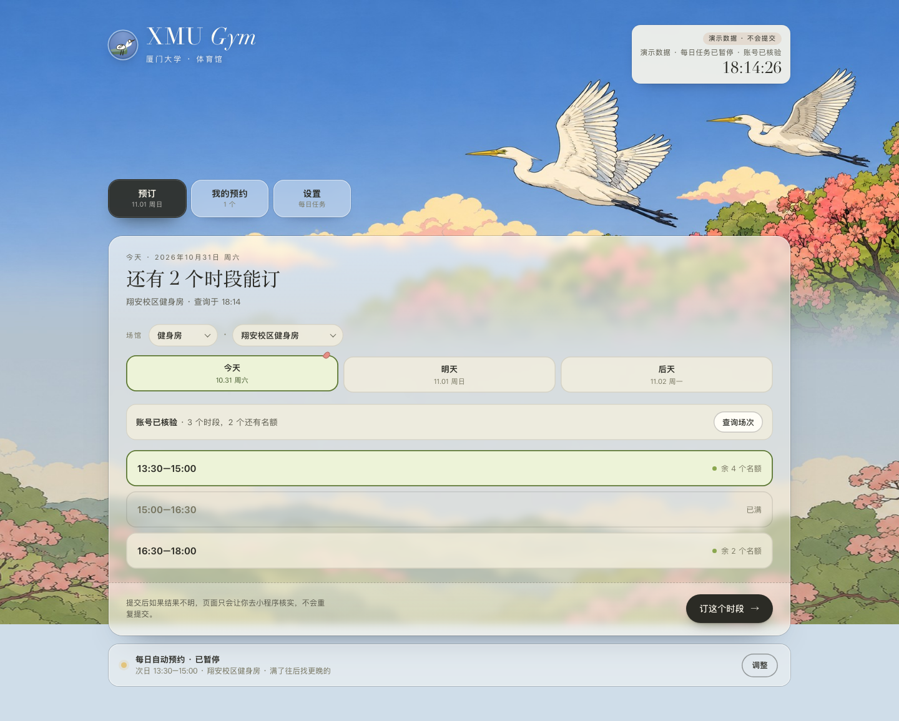

# PF Zhang Toolkit

[中文文档](./README.zh.md)

A personal collection of reusable tools and experiments maintained by [pfzhang-xmu](https://github.com/pfzhang-xmu). The repository brings together three kinds of content:

- `plugins/` — plugins that add tools, integrations, or host capabilities.
- `skills/` — standalone skills that can be reused by AI agents.
- `projects/` — complete applications and other larger projects.

## Contents

### Plugins

- [`dsh-cowart`](./plugins/dsh-cowart) — tldraw infinite canvas, image annotation, and refinement workflows.
- [`dsh-github-workspace`](./plugins/dsh-github-workspace) — GitHub CLI workspace integration.
- [`dsh-image-tools`](./plugins/dsh-image-tools) — OpenAI Images-compatible image generation and editing tools.

### Skills

The [`skills/`](./skills) directory contains reusable agent skills, organized by category:

- [Office and document skills](./skills/office) — DOCX, PPTX, XLSX, PDF, and Markdown conversion workflows.
- [Grilling](./skills/grilling) — stress-test plans, decisions, and ideas through rounds of structured questions.
- [Humanizer Academic](./skills/humanizer-academic) — edit academic medical prose to reduce formulaic AI-writing patterns while preserving scientific meaning and journal tone.
- [AnySearch](./skills/anysearch) — unified real-time web search skill with general, vertical, batch-search, and full-page extraction support.

See the [skills catalog](./skills/README.md) for the full index, direct links, Raw downloads, and installation guidance.

### Projects

- [`dsh-figureforge`](./projects/dsh-figureforge) — browser-local scientific figure editor.
- [`paper-workbench`](./projects/paper-workbench) — end-to-end academic writing, review, data, figure, and export workbench.
- [`xmu-gym`](./projects/xmu-gym) — local-first XMU sports venue booking console for macOS and Windows.

## Paper Workbench

Paper Workbench provides a local CLI, Web UI, desktop wrapper, MCP server, AI-assisted writing workflow, versioned AI scientific figure generation, reference-image editing, and FigureForge integration.

Quick deployment:

```bash
git clone https://github.com/pfzhang-xmu/pfzhang-toolkit.git
cd pfzhang-toolkit/projects/paper-workbench
python3.12 -m venv .venv
.venv/bin/pip install -r requirements.txt
./start-workbench.sh
```

Then open `http://127.0.0.1:8123`.

The checked-in `app_config.example.json` contains no credentials. Copy it to `app_config.json` and configure API keys locally or through environment variables. Runtime data under `data/` and local settings are intentionally ignored by Git.

## Versioning and updates

Paper Workbench development happens on `main`. Stable snapshots use tags such as `paper-workbench-v0.1.0`. From an installed checkout, run `./update-workbench.sh` to back up local configuration/data, fast-forward the source tree, refresh dependencies, and preserve runtime data.

See each project or plugin directory for its own usage, migration, testing, and license details.

## XMU Gym

XMU Gym is a local-first booking console for Xiamen University sports venues. It reads the logged-in XMU mini program session from WeChat's local storage, then gives you a page for availability, booking, cancellation, entry QR, and a 06:58 / 07:00 daily job. macOS and Windows share the same Python + static-web stack; WeChat via Hermes is an optional notification/chat layer.



Quick start:

```bash
git clone https://github.com/pfzhang-xmu/pfzhang-toolkit.git
cd pfzhang-toolkit/projects/xmu-gym
./scripts/setup-macos.sh
./scripts/start-macos.command
```

Windows: run `powershell -ExecutionPolicy Bypass -File scripts\setup-windows.ps1`, then `scripts\start-windows.bat`. See [`projects/xmu-gym/README.md`](./projects/xmu-gym/README.md) for the full setup, safety rules, and troubleshooting.

## License

Each directory keeps its own license. Paper Workbench, FigureForge, and XMU Gym are MIT-licensed unless noted otherwise.
