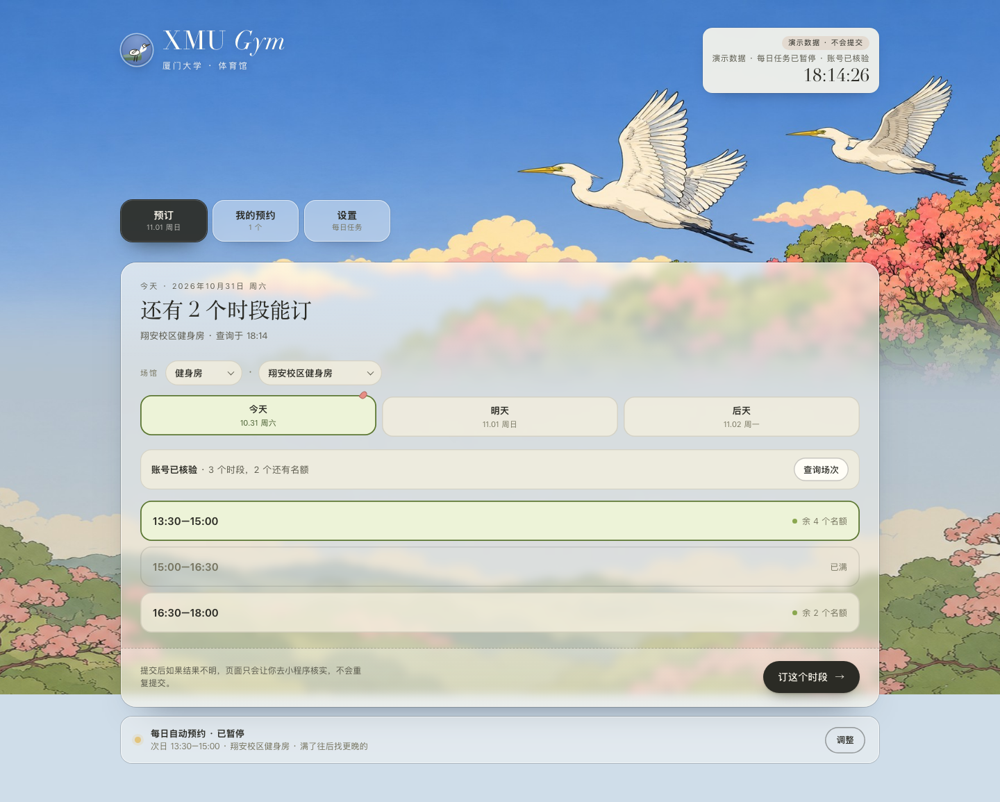
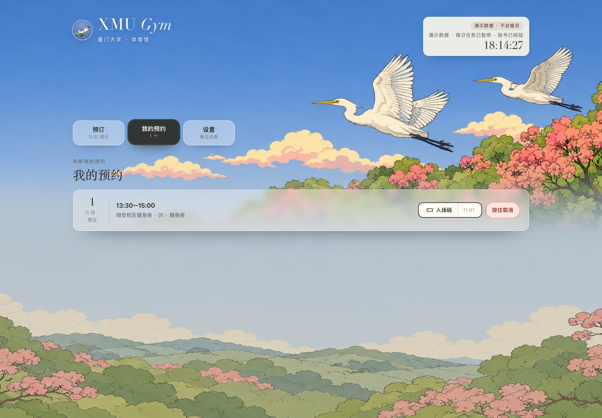
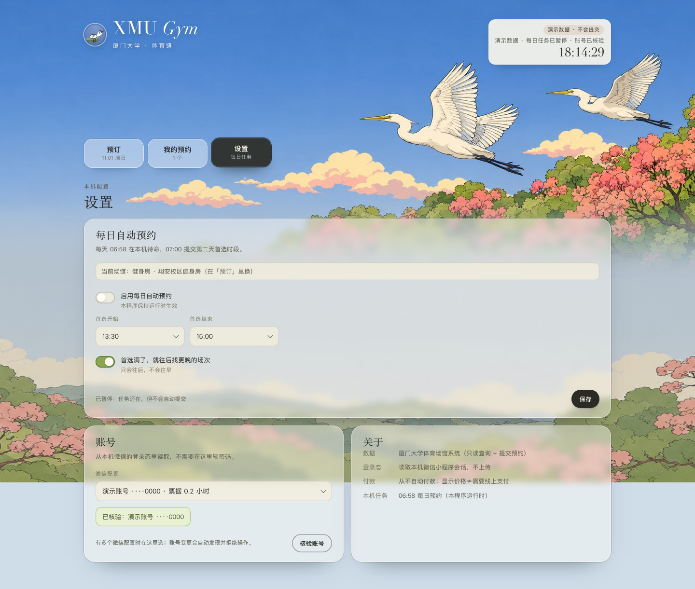
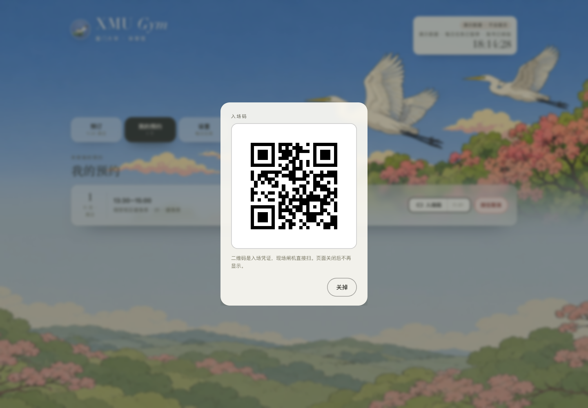
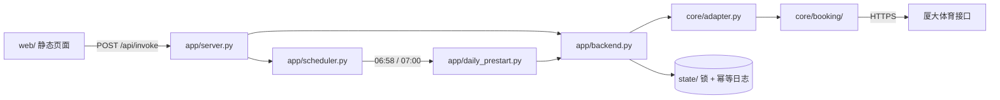

# XMU Gym｜厦大体育场馆预约控制台

> **English summary** · A local-first booking console for Xiamen University sports
> venues. It reads the logged-in XMU mini program session from WeChat's local
> storage, then gives you a page to check availability, book, cancel, show the
> entry QR, and run a 06:58 / 07:00 daily booking job. macOS and Windows share the
> same Python + static-web stack. WeChat via Hermes is an optional notification /
> chat layer, not a requirement for using the page.

[](https://www.python.org/)
[](#平台与前置条件)
[](LICENSE)



---

## 这是什么

XMU Gym 是一个**只在本机运行**的厦大体育场馆预约台：

- 页面是主入口：查场次、选时段、提交预约、看我的预约、取消、入场码、每日任务开关。
- 登录态从电脑微信里「厦大体育」小程序的本地缓存读取，不需要在页面输密码。
- 每天 06:58 预热、07:00 提交次日场次；满额时只往后找更晚的时段。
- 可选把结果和入场码发到微信；可选在聊天里让 agent 帮你查/约/取消。
- 所有预约安全逻辑（跨进程锁、幂等键、结果不明不重试、取消窗口）都在本地。

**它不是**：学校官方应用；不是代约/售卖工具；不会自动付款；不会上传你的账号或订单。

---

## 功能

| 能力 | 页面 | 说明 |
|---|---|---|
| 账号核验 | 预订页 / 设置 → 账号 | 读取本机微信登录态，绑定账号指纹；换账号会拒绝操作 |
| 多微信配置 | 设置 → 账号 | Windows 常见多个 `webview_*`；下拉选账号，脱敏显示尾号 |
| 查场次 | 预订页 | 今天 / 明天 / 后天；显示每个时段的余量，锁定与满额分开 |
| 立即预约 | 预订页 | 提交前确认场馆/日期/时段；结果不明只提示去小程序核对 |
| 我的预约 | 我的预约 | 进行中的订单、场地、时段；开始前 1 小时以上才可取消 |
| 入场码 | 我的预约 → 入场码 | 实时核验后在本机生成 PNG；页面不缓存、不写日志 |
| 每日自动预约 | 设置 → 每日自动预约 | 06:58 预热、07:00 提交；可只往后找更晚时段 |
| 内置调度器 | 设置开关 | 不依赖 Hermes；程序运行时生效，页面显示状态 |
| 防睡眠 | 启动时 | macOS `caffeinate -i`；Windows `SetThreadExecutionState` |
| 演示模式 | `--demo` | 假数据、假二维码，不读微信、不提交；用于预览/截图 |
| 可选通知 | `notify` | Hermes 微信通知或通用 webhook；默认只在页面显示 |

### 安全取向

- 提交前必须过确认框；取消必须**按住 1 秒**。
- 提交结果不明（`SUBMIT_UNKNOWN` / 未核实 / 中断）**一律停止，不重试**。
- 只读失败（查场次、读订单）不会伪装成“提交失败”，文案明确写“没有提交任何预约”。
- 支付包视为未确认，**不自动付款**。
- 页面只绑 `127.0.0.1`；POST 校验 `Host`、`Origin` 和自定义请求头。

---

## 界面

以下截图全部来自 `--demo` 演示数据，不含真实账号、订单或二维码。

| 预订 | 我的预约 |
|---|---|
|  |  |

| 每日任务 / 账号 | 入场码 |
|---|---|
|  |  |

---

## 平台与前置条件

| | macOS | Windows |
|---|---|---|
| 系统 | macOS 13+ | Windows 10/11 |
| Python | 3.12 | 3.12（x64） |
| Git | 需要（clone 仓库） | 需要（clone 仓库） |
| 微信 | 微信 4.x（Mac） | 微信 4.x（`xwechat`） |
| 小程序 | 电脑微信打开「厦大体育」并进入一次「场馆预约」 | 同上 |
| 权限 | 启动终端/IDE 需要「完全磁盘访问权限」才能读微信容器 | 无需额外权限；微信保持登录 |
| 浏览器 | Chrome / Safari / Edge 均可 | Edge / Chrome |

> Windows 的微信 3.x 使用不同的本地存储目录，不在本项目的支持范围；请先升级到 4.x。

---

## 快速开始

### macOS

```bash
git clone https://github.com/pfzhang-xmu/pfzhang-toolkit.git
cd pfzhang-toolkit/projects/xmu-gym
./scripts/setup-macos.sh
./scripts/start-macos.command
```

浏览器会自动打开 `http://127.0.0.1:1420/`。第一次读微信缓存如果报 `SESSION_READ_FAILED`：

1. 系统设置 → 隐私与安全性 → 完全磁盘访问权限；
2. 把你启动命令的终端（Terminal / iTerm / VS Code）加进去；
3. 完全退出终端再重开，重新运行。

### Windows

先装 Python 3.12（没有的话）：

```powershell
winget install Python.Python.3.12
```

然后：

```powershell
git clone https://github.com/pfzhang-xmu/pfzhang-toolkit.git
cd pfzhang-toolkit\projects\xmu-gym
powershell -ExecutionPolicy Bypass -File scripts\setup-windows.ps1
scripts\start-windows.bat
```

`setup-windows.ps1` 会建 `.venv`、装依赖、在桌面创建 `XMU Gym` 快捷方式。浏览器打开 `http://127.0.0.1:1420/`。

Windows 真机第一次跑，按 [`docs/windows-checklist.md`](docs/windows-checklist.md) 的顺序做：先演示模式，再只读 `auth`/`slots`/`orders`，最后才真实预约。

### 演示模式（不需要微信）

```bash
# macOS
./scripts/start-macos.command --demo --port 1431

# Windows
scripts\start-windows.bat --demo --port 1431
```

页面右上角会显示「演示数据 · 不会提交」。适合先看界面、截图、给别人演示。

---

## 首次使用（5 步）

1. **准备登录态**：电脑微信 → 打开「厦大体育」小程序 → 进入一次「场馆预约」。
   之后不需要一直停在那个页面，但微信要保持登录。
2. **打开页面**：`http://127.0.0.1:1420/`。页面会自动尝试核验账号。
3. **选微信配置**：设置 → 账号 → 「微信配置」下拉。只有一个配置时自动选中；
   多个时选你当前微信登录的那个（显示 `账号 ····1234`，不是完整 UID）。
4. **核验账号**：点「核验账号」。成功会显示「已核验：账号 ····1234」。
5. **选场馆/日期/时段**：预订页 → 场馆下拉 → 今天/明天/后天 → 点一个有余量的时段 →
   「订这个时段」→ 确认框。提交后只有 `verified` 才会报成功。

> 预约和取消都是真实副作用。第一次用建议先拿一个不重要的时段试，确认页面能读到你的账号和订单。

---

## 每日自动预约

### 开启

1. 设置 → 每日自动预约；
2. 选首选开始/结束时间；
3. 勾选「首选满了，就往后找更晚的场次」（可选，只会往后，不会往早）；
4. 打开「启用每日自动预约」；
5. 点「保存」。

保存后页面会显示「已启用：每天 06:58 待命，07:00 提交」。

### 它怎么跑

- **06:58** 调度器启动入口；**06:59:30** 做一次只读账号预热；**07:00** 正式提交次日场次。
- 执行窗口 07:00–07:20；首选明确不可约时才按开始时间升序尝试更晚的时段（最多 8 个）。
- 登录态类失败（`NO_ENTRY` / `SESSION_EXPIRED` / `AUTH_FAILED`）发生在提交前，会明确告诉你“今天没提交”。
- 提交结果不明会保留标记并停止；**不要重试**，先到小程序「我的预约」核对。

### 必须保持程序运行

内置调度器是页面服务里的一个线程，**程序不在跑就不会预约**。两种做法：

```bash
# macOS：登录自启（launchd）
./scripts/install-autostart-macos.sh

# Windows：登录自启（任务计划程序）
powershell -ExecutionPolicy Bypass -File scripts\install-autostart-windows.ps1
```

如果 macOS 登录自启后报 `SESSION_READ_FAILED`、但手动 `start-macos.command` 正常：给 `.venv/bin/python`（或启动它的 Python.app）加「完全磁盘访问权限」，或者继续用终端手动启动。

程序运行时会尝试阻止空闲睡眠（macOS `caffeinate -i`，Windows `SetThreadExecutionState`），但：

- 合盖、手动睡眠、关机、断网仍然会失败；
- 建议 06:50 前确认电脑已唤醒、微信已登录；
- 不要把内置调度器和 Hermes cron 同时开着——只启用一个。

### 查看结果

- 页面顶部纸条 / 设置页会显示调度状态；
- 运行记录在 `state/scheduler.json`（含时间、状态、最后一条输出）；
- 可选通知见下一节。

---

## 微信通知（可选）

页面本身已经能完成全部操作；微信只是“结果送到手机上”和“聊天里让 agent 代操作”的可选层。

### 方式 A：Hermes（推荐给已经在用 Hermes 的人）

1. 让 Hermes 连接你的微信（Hermes 的 Weixin/iLink 网关，或你自己的适配器）。
2. 在 Hermes 里建一个 `no_agent` cron：

   - 时间：每天 **07:02**
   - 命令：

     ```bash
     cd <项目绝对路径> && .venv/bin/python -m app.cli notify --latest
     ```

   - 投递：`weixin`

`notify --latest` 只打印最近一次调度结果；没有结果时退出 1，不会发空消息。
如果结果里带入场码，页面仍建议以小程序原生码为准（见「已知限制」）。

### 方式 B：通用 webhook

编辑 `state/config.json`：

```json
{
  "notify": {
    "webhook_url": "https://your-webhook.example/xmu-gym",
    "hermes": false
  }
}
```

然后：

```bash
.venv/bin/python -m app.cli notify --latest
```

会 POST `{"text": "...", "source": "xmu-gym"}`。适合接自己的 bot / Server 酱 / 企业微信机器人。

### 方式 C：聊天里预约/取消（可选技能模板）

把 [`integrations/hermes/SKILL.md`](integrations/hermes/SKILL.md) 复制到你 agent 的技能目录，
它会把“约明天下午健身房”翻译成 `app/cli.py` 命令，并带上硬规则（不重试、不自动付款、入场码不外发）。

---

## 命令行

页面能做的事，命令行都能做；适合 agent 和脚本。

```bash
.venv/bin/python -m app.cli auth
.venv/bin/python -m app.cli profiles
.venv/bin/python -m app.cli slots --date tomorrow --sport 健身房 --venue 翔安校区健身房
.venv/bin/python -m app.cli book --date tomorrow --start 13:30 --end 15:00 --yes
.venv/bin/python -m app.cli orders
.venv/bin/python -m app.cli cancel --order next --yes
.venv/bin/python -m app.cli qr --order next
.venv/bin/python -m app.cli daily show
.venv/bin/python -m app.cli daily set --start 13:30 --end 15:00 --fallback
.venv/bin/python -m app.cli scheduler status
.venv/bin/python -m app.cli scheduler enable
.venv/bin/python -m app.cli notify --latest
.venv/bin/python -m app.cli info
```

Windows 把 `.venv/bin/python` 换成 `.venv\Scripts\python.exe`。

`book` / `cancel` 必须带 `--yes`；`--date` 支持 `today` / `tomorrow` / `YYYY-MM-DD`。
`slots` 和 `orders` 是只读的，不会提交任何东西。

---

## 给 agent 的快速配置

把下面这段直接丢给你的 agent（Claude Code / Codex / Hermes / 其他）：

```text
你在 macOS 或 Windows 上配置 XMU Gym（厦大体育场馆预约控制台）。
项目地址：https://github.com/pfzhang-xmu/pfzhang-toolkit/tree/main/projects/xmu-gym

步骤：
1. git clone https://github.com/pfzhang-xmu/pfzhang-toolkit.git
2. cd pfzhang-toolkit/projects/xmu-gym
3. macOS: ./scripts/setup-macos.sh；Windows: powershell -ExecutionPolicy Bypass -File scripts\setup-windows.ps1
4. 启动：macOS ./scripts/start-macos.command；Windows scripts\start-windows.bat
5. 打开 http://127.0.0.1:1420/，先点「核验账号」；如果读不到微信，按 README 的完全磁盘访问权限处理。
6. 先用 `python -m app.cli slots --date tomorrow` 做只读验证，不要一上来就 book。

硬规则：
- 不自动付款。
- 提交结果不明（SUBMIT_UNKNOWN / 未核实 / 中断）绝不重试，先查「我的预约」。
- 预约/取消是真实副作用；CLI 必须带 --yes；取消只允许开始前 1 小时以上。
- 账号指纹和入场码都是敏感信息，不要写日志、不要发群。
- 只启用一个调度器（内置或 Hermes cron），不要同时开。
- 详细目录和测试命令见 docs/agent-guide.md。
```

更完整的目录/命令/硬规则见 [`docs/agent-guide.md`](docs/agent-guide.md)。

---

## 架构



| 层 | 职责 |
|---|---|
| `web/` | 纯静态页面；无构建链；只调 `/api/invoke` |
| `app/server.py` | 本地 HTTP、静态文件、Host/Origin 校验、调度状态 |
| `app/backend.py` | 账号核验、场次、订单、取消、预约；跨进程锁和幂等标记 |
| `app/daily.py` | 每日策略、执行、通知文本、二维码落盘 |
| `app/scheduler.py` | 06:58 线程；页面开关；不依赖 Hermes |
| `core/adapter.py` | 微信 profile 发现、账号指纹、每日预约适配 |
| `core/booking/` | 会话读取、场次、提交、订单、验证码 |
| `core/platform.py` | macOS/Windows 路径、活跃 profile、防睡眠 |
| `core/locks.py` | `fcntl` / `msvcrt` 文件锁 |

### 关键安全不变量

1. 账号指纹（SHA-256(UID)）绑定；每次操作重新核验，不一致就拒绝。
2. 跨进程锁 + 持久化尝试标记 + 幂等键；重复提交会被挡住。
3. 结果不明一律 fail closed；只读失败和提交失败分开措辞。
4. 取消前服务端再次检查账号、订单状态和“开始前 1 小时”限制。
5. 入场码只读订单接口；在内存生成 PNG；不缓存、不记录载荷。
6. 支付包视为未确认；不自动付款。

---

## 安全与隐私

- **只绑 `127.0.0.1`**：页面和 API 不对外网开放；不要把端口转发到公网。
- **不上传数据**：账号、订单、二维码都留在本机；没有云端服务。
- **`state/` 是敏感目录**：包含账号指纹、预约尝试、订单缓存、二维码临时文件。
  - 不要提交到 Git；不要发给别人；不要放在共享目录。
  - 目录权限 0700，文件 0600（Windows 上权限模型不同，但仍不要共享）。
- **入场码是凭证**：页面关闭后不再显示；不要截图发群、不要贴到文档。
  通知用的二维码会临时写到 `state/outbox/`（文件 0600，下次保存时清理 48 小时以上的旧图），用完请删。
- **账号指纹**：不是登录 token，但仍能关联到你的账号；只显示脱敏尾号。
- **不要与其他预约工具并发**：本项目的锁只覆盖自己的 `state/`，其他工具的未决日志看不到。

---

## 故障排查

| 现象 | 原因 / 处理 |
|---|---|
| `NO_ENTRY` / `no usable profile` | 微信没登录、没打开过「厦大体育」，或小程序 webview 被回收。打开小程序进一次「场馆预约」再核验。 |
| `SESSION_READ_FAILED` | 当前进程读不到微信容器。macOS 给终端/IDE 完全磁盘访问权限；Windows 确认微信 4.x 且目录存在。 |
| `SESSION_EXPIRED` | 票据过期。重新在小程序登录，再核验。 |
| `AMBIGUOUS_PROFILE` | 有多个可用微信配置。设置 → 账号 → 选当前微信配置；或命令行 `profiles` 后 `select_profile`。 |
| `NOT_OPEN` | 北京时间 00:00–06:59 不能提交当天预约；等 07:00 后。 |
| `DATE_NOT_OPEN` | 只能约今天/明天；后天要等次日 07:00 放号。 |
| `BOOKING_CLOSED` | 目标时段已开始。 |
| `SUBMIT_UNKNOWN` / `RESULT_UNCONFIRMED` | **不要重试**。到微信「我的预约」核对；确认没有再手动补。 |
| 页面打不开 / 端口占用 | 换端口：`--port 1432`；或关掉占用 1420 的进程。 |
| 07:00 没执行 | 程序没运行、电脑睡眠、微信没登录、调度开关没开。看 `state/scheduler.json` 和页面顶部状态。 |
| Windows 找不到微信目录 | 微信 3.x 不支持；升级到 4.x（`%APPDATA%\Tencent\xwechat\radium\web\profiles`）。 |
| 入场码扫不出来 | 以小程序原生码为准；本机生成的码现场闸机未做全量实测。 |
| 微信收不到通知 | Hermes 网关/微信登录问题；页面本身不受影响。 |

---

## 已知限制

- **每日 07:00 自动预约依赖微信登录态**：票据通常能撑几天，但过期后必须重新在小程序登录；本项目不会自动模拟登录。
- **不自动打开/登录小程序**：微信界面元素不可靠，自动点击未实现；只做只读检查和提示。
- **入场码**：本机生成、内容与官方一致；现场闸机是否接受未做全量实测，建议优先用小程序原生码。
- **Windows 真机验证**：代码路径已适配 macOS/Windows；Windows 的微信 4.x 读取需要你在本机跑一次 `auth`/`slots` 确认。
- **学校接口可能变化**：场次、验证码、登录方式变化时，项目可能需要更新。
- **不承诺预约成功**：余量是查询时快照，最终以学校接口为准。

---

## 开发与测试

```bash
python3.12 -m venv .venv
.venv/bin/pip install -r requirements.txt
.venv/bin/pip install -r requirements-dev.txt

# 离线测试（不读微信、不联网）
.venv/bin/python -m pytest tests -q

# 浏览器测试（需要 Playwright）
.venv/bin/playwright install chromium
.venv/bin/python -m pytest tests/test_daily_ui.py -q
```

当前测试：352 passed（含 4 个 Playwright 页面测试）。测试使用假数据/替身，不会提交真实预约。

### 目录

```text
app/        server / backend / daily / scheduler / cli / demo / config / notify
core/       adapter / platform / locks / booking（预约核心）
web/        静态页面（无构建链）
scripts/    macOS/Windows 安装、启动、自启
tests/      离线测试 + Playwright 页面测试
docs/       截图、agent 指南、架构
vendor/     两个不在 PyPI 的纯 Python wheel（免 Git 安装）
```

### 设计约束

- 页面保持无构建链：`index.html` + `styles.css` + `app.js` + `catalog.js`。
- 中文文案；错误信息先讲“有没有提交”，再讲下一步。
- 只读失败和提交失败分开措辞；不要把查询失败说成“结果不明”。
- 跨平台差异只放在 `core/platform.py` 和 `core/locks.py`。

---

## 版本

- `0.1.0` — 首个公开版本：页面、macOS/Windows 启动脚本、内置调度器、演示模式、可选 Hermes 通知/聊天模板。

---

## 许可证与第三方

本项目自身代码使用 MIT，见 [`LICENSE`](LICENSE)。

`core/booking/` 的一部分衍生自 MIT 许可的开源项目；按 MIT 要求保留版权和许可声明，
完整清单见 [`THIRD_PARTY_NOTICES.md`](THIRD_PARTY_NOTICES.md)。产品界面、文档和品牌均为 XMU Gym，
第三方声明仅用于合规，不代表与原项目有隶属或背书关系。

---

## 免责声明

- 本项目**不是**厦门大学官方应用，与学校、微信均无隶属或背书关系。
- 仅用于**本人账号**的预约辅助；不要代约、售卖、批量刷号或绕过学校规则。
- 使用前请阅读并遵守厦门大学体育场馆的预约规则；账号风险由使用者自行承担。
- 不自动付款；价格显示不代表需要线上支付。
- 学校接口、微信版本或小程序结构变化可能导致功能失效，维护者不承诺持续可用。
